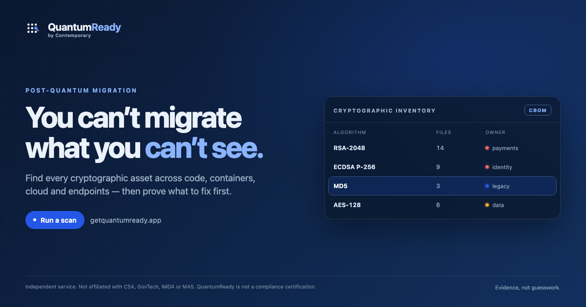

<p align="center">
  
</p>

<h1 align="center">QuantumReady CBOM profile</h1>

<p align="center">
  <strong>Cryptographic inventory for post-quantum migration</strong><br>
  by <a href="https://getquantumready.app">Contemporary</a>
</p>

<p align="center">
  <a href="https://getquantumready.app">Website</a> ·
  <a href="https://getquantumready.app/sample-report">Sample report</a> ·
  <a href="https://getquantumready.app/methodology">Methodology</a> ·
  <a href="https://getquantumready.app/contact">Contact</a>
</p>



A public profile for expressing **post-quantum migration evidence** in a CycloneDX 1.7
cryptographic bill of materials (CBOM).

QuantumReady is a cryptographic discovery service by **Contemporary**. This repository
publishes the parts that are useful to everyone: the profile, a worked example, and a
validator. The scanner itself is proprietary and is not in this repository.

## Why a profile

A useful CBOM has to answer five questions, not one:

1. **What** algorithm or primitive is it?
2. **Where** was it found — file, line, image, endpoint, certificate?
3. **Which environment** does it affect — production, test, build?
4. **Who owns the fix** — your code, a dependency, a platform, a vendor?
5. **What is the evidence and the action** — detected, build-confirmed, runtime-confirmed;
   fix now, plan, monitor?

CycloneDX 1.7 already carries the cryptographic asset. This profile adds the migration
fields in a documented `quantumready:` property namespace so that two tools can exchange
the same finding without guessing.

## What is here

| Path | What it is |
|---|---|
| [`PROFILE.md`](PROFILE.md) | The `quantumready:` property namespace and its rules |
| [`examples/repository-scan.cbom.json`](examples/repository-scan.cbom.json) | A real, redacted repository scan |
| [`validator/`](validator/) | A zero-dependency Node validator |
| [`.github/workflows/validate.yml`](.github/workflows/validate.yml) | CI example |

## Quick start

```bash
node validator/index.mjs examples/repository-scan.cbom.json
```

Expected output:

```
OK  examples/repository-scan.cbom.json
    CycloneDX 1.7 · 1 component · 30 metadata properties
```

The validator checks structure and the profile's required properties. It does not
re-scan code and it does not certify compliance.

## Name and descriptor

The product is **QuantumReady**. The company is **Contemporary**. The descriptor is
**cryptographic inventory for post-quantum migration**.

Use the full lockup at first mention in a new context:

> **QuantumReady by Contemporary — cryptographic inventory for post-quantum migration.**

After that, “QuantumReady” alone is fine. The descriptor is not a slogan and it is not a
second product name; it is the category phrase that tells a reader what the product does.
QuantumReady is an independent service. It is not affiliated with Sectigo, the Cyber
Security Agency of Singapore (CSA), GovTech, IMDA or MAS.

## Status

- Profile version: **0.1**
- Aligned with: QuantumReady Discovery Engine **0.10.x**
- CycloneDX: **1.7**

Backwards-incompatible changes get a new profile version. Additive properties do not.

## Contributing

Issues and pull requests are welcome when they make the profile easier to implement
correctly. Please read [`CONTRIBUTING.md`](CONTRIBUTING.md). Do not submit scanner source
code or customer data.

## License

- Documentation and the profile: [CC BY 4.0](LICENSE-DOCS)
- Validator code: [MIT](LICENSE-CODE)

---

<sub>QuantumReady by Contemporary. The scanner is proprietary; this repository contains
the public profile, examples and validator only.</sub>
